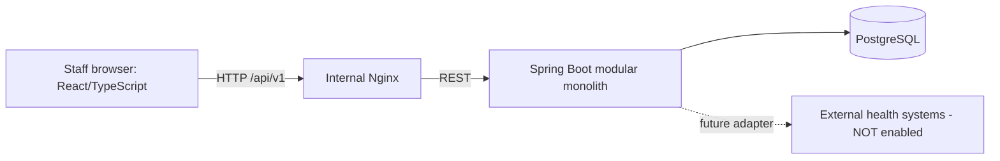

# HMS Community — Hospital Management System

[](#continuous-integration) [](LICENSE)

**SENG 321 / BM 321 — University team project · Community edition**

A modular-monolith foundation for a single-hospital, on-premises, browser-based Hospital Management System (HMS/HBYS).

> **Course prototype only.** This repository is a teaching scaffold, NOT a medical device or deployment-ready hospital information system. Use synthetic test data only. No real patient data, live hospital connections, or production use.


## Scope and design

- **Team / public:** `hms-community` under Apache License 2.0 **subject to verifying contributor rights and university policies before publication**.
- **Personal / private:** any separately developed Enterprise modules belong in a **different private repository** and are **not included here**.
- **Intended hosting:** application within the hospital's private LAN. Internet-facing patient portal and regulated integrations are deferred.
- **Current state:** architecture + GitHub workflow + OpenAPI **draft** + running **health-only scaffold**. Domain API endpoints in the draft are NOT implemented yet.

### Eight Community modules

| # | Module | Java package | Responsibility | First release |
|--:|--|--|--|--|
| 1 | Patient Management | `patients` | Patient identity/profile and registration | Core |
| 2 | Appointment Management | `appointments` | Schedules, appointments and conflicts | Core |
| 3 | Doctor & Staff Management | `staff` | Clinician directory and assignments | Core |
| 4 | Outpatient Management | `outpatient` | Visits and encounter lifecycle | Core |
| 5 | Electronic Medical Records | `records` | Clinical notes and diagnoses | Core |
| 6 | Laboratory Management | `laboratory` | Orders and test results (mocked lab) | Core |
| 7 | Inpatient & Bed Management | `inpatient` | Admissions, ward and bed occupancy | Deferred within Community |
| 8 | Authentication, Authorization & Audit | `security` | Roles, permissions, traceability | Cross-cutting foundation |

**Planned MVP journey:** register patient → select clinician and time → create appointment → start outpatient encounter → request lab test → enter synthetic result → view result in encounter.

## Architecture



- Architectural style: **modular monolith**, not microservices (see [ADR-001](docs/adr/0001-modular-monolith.md)).
- Backend: Java 21, Spring Boot 3.5.x, Spring Security; planned layered structure: `api → application → domain → infrastructure` per module.
- Frontend: React + TypeScript + Vite, Nginx for container serving/proxy.
- Data: PostgreSQL; domain schema **not implemented** in this foundation stage.
- Interfaces: [OpenAPI 3.1 draft](api/openapi.yaml); `401/403/404/409` modeled where appropriate.
- Cross-module rule: business logic belongs to its owning module, no direct access to another module's internal repositories; interfaces and IDs/event contracts at boundaries.
- More: [Architecture index](docs/architecture/README.md), [C4 diagrams](docs/architecture/c4-context.mmd), [domain model](docs/architecture/domain-model.mmd).

## Local demo (non-production)

Requires Docker Compose:

```bash
docker compose up --build
```

Visit **http://localhost:8080**. Frontend displays the backend health status. The database and backend have **no published host ports**. The published frontend port is bound to `127.0.0.1`, not a hospital network interface.

```bash
docker compose down
```

**No hospital-ready UI or patient workflows are implemented yet.** The test-only DB password in `compose.yaml` is a local fallback and must not be used outside a private development machine. The project requires authentication, TLS, backups, authorization tests, regulatory review, resilience and operational safeguards before any real clinical use.

## Run tests and checks

```bash
# Requires Java 21 and Maven 3.9+
cd backend && mvn test

# Requires Node 22+; first npm install creates package-lock.json; commit the lockfile
cd frontend && npm install && npm run build

# Optional: pip install PyYAML openapi-spec-validator, then
python scripts/validate_openapi.py
```

GitHub Actions runs Maven tests, frontend build, OpenAPI 3.1 schema validation, and a simple repository-scope check. A JaCoCo coverage report is configured. **50% unit-test coverage is a Sprint 3 target; it is not claimed yet.** CI jobs install dependencies from their standard upstream registries.

## Sprint 1 / course evidence

1. [Project proposal](docs/sprint-1/project-proposal.md)
2. [Vision and system boundary](docs/sprint-1/vision-and-boundary.md)
3. [OpenAPI contract](api/openapi.yaml)
4. [Role ownership and RACI](docs/sprint-1/raci.md)
5. [Git-Flow and PR policy](docs/sprint-1/git-workflow.md)
6. [Initial backlog](docs/sprint-1/backlog.md)

Every member must work from their own GitHub account and provide issues, commits, PRs, reviews, and test evidence. Fill in the `TBD` owners before assessment. Use [Sprint 1 checklist](docs/sprint-1/submission-checklist.md).

## Continuous integration

Workflow: [`.github/workflows/ci.yml`](.github/workflows/ci.yml). Enable protected `main`/`develop` branches in the GitHub UI (instructions in [Git workflow](docs/sprint-1/git-workflow.md)); a text file alone cannot enforce rulesets.

## Licenses and ownership

[LICENSE](LICENSE) contains Apache-2.0 text. It is a **proposal** until the actual rights holders and university approve publication. Contributors retain applicable rights unless separately agreed; no document in this repository transfers copyrights or grants exclusive Enterprise rights. Review dependency licenses before release. See [Open-Core ADR](docs/adr/0003-open-core-boundary.md).
