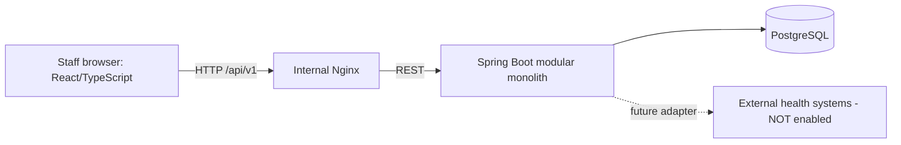

# HMS Community — Hospital Management System

[](#continuous-integration) [](LICENSE)

**SENG 321 / BM 321 — University team project · Community edition**

A modular-monolith foundation for a single-hospital, on-premises, browser-based Hospital Management System (HMS/HBYS).

> **Course prototype only.** This repository is a teaching scaffold, NOT a medical device or deployment-ready hospital information system. Use synthetic test data only. No real patient data, live hospital connections, or production use.

## Scope and design

- **Team / public:** `hms-community` under Apache License 2.0 **subject to verifying contributor rights and university policies before publication**.
- **Personal / private:** any separately developed Enterprise modules belong in a **different private repository** and are **not included here**.
- **Intended hosting:** application within the hospital's private LAN. Internet-facing patient portal and regulated integrations are deferred.
- **Current state:** architecture + GitHub workflow + OpenAPI **draft** + running **health-only scaffold**. Domain API endpoints in the draft are NOT implemented yet.

### Eight Community modules

| # | Module | Java package | Responsibility | First release |
|--:|--|--|--|--|
| 1 | Patient Management | `patients` | Patient identity/profile and registration | Core |
| 2 | Appointment Management | `appointments` | Schedules, appointments and conflicts | Core |
| 3 | Doctor & Staff Management | `staff` | Clinician directory and assignments | Core |
| 4 | Outpatient Management | `outpatient` | Visits and encounter lifecycle | Core |
| 5 | Electronic Medical Records | `records` | Clinical notes and diagnoses | Core |
| 6 | Laboratory Management | `laboratory` | Orders and test results (mocked lab) | Final extension |
| 7 | Inpatient & Bed Management | `inpatient` | Admissions, ward and bed occupancy | Deferred / optional |
| 8 | Authentication, Authorization & Audit | `security` | Roles, permissions, traceability | Cross-cutting foundation |

### Planned release scope

**Planned MVP journey (Sprint 3 — Week 8):**

Staff login → register patient → select clinician and time → create appointment → view physician daily schedule → start outpatient examination → record examination notes and diagnosis → review medical history and allergies → complete examination.

**Planned Final extension (Week 10):**

Request laboratory tests → enter synthetic laboratory results → review results within the physician workflow.

**Optional features:** Should/Could backlog items may be included depending on team capacity.

**Out of scope this term:** Full inpatient admission and discharge workflows (US-23).

## Architecture



- Architectural style: **modular monolith**, not microservices (see [ADR-001](docs/adr/0001-modular-monolith.md)).
- Backend: Java 21, Spring Boot 3.5.x, Spring Security; planned layered structure: `api → application → domain → infrastructure` per module.
- Frontend: React + TypeScript + Vite, Nginx for container serving/proxy.
- Data: PostgreSQL; domain schema **not implemented** in this foundation stage.
- Interfaces: [OpenAPI 3.1 draft](api/openapi.yaml); `401/403/404/409` modeled where appropriate.
- Cross-module rule: business logic belongs to its owning module, no direct access to another module's internal repositories; interfaces and IDs/event contracts at boundaries.
- More: [Architecture index](docs/architecture/README.md), [C4 diagrams](docs/architecture/c4-context.mmd), [domain model](docs/architecture/domain-model.mmd).

## Local demo (non-production)

Requires Docker Compose:

```bash
docker compose up --build
```

Visit **http://localhost:8080**. Frontend displays the backend health status. The database and backend have **no published host ports**. The published frontend port is bound to `127.0.0.1`, not a hospital network interface.

```bash
docker compose down
```

**No hospital-ready UI or patient workflows are implemented yet.** The test-only DB password in `compose.yaml` is a local fallback and must not be used outside a private development machine.

The project requires authentication, TLS, backups, authorization tests, regulatory review, resilience and operational safeguards before any real clinical use.

## Run tests and checks

### Backend

Requires Java 21 and Maven 3.9+.

```bash
cd backend
mvn test
```

### Frontend

Requires Node.js 22+.

```bash
cd frontend
npm install
npm run build
```

The `package-lock.json` file should be committed for reproducible dependency installation.

### OpenAPI validation

Requires Python 3 and the validation dependencies.

```bash
python -m pip install PyYAML openapi-spec-validator
python scripts/validate_openapi.py
```

The validation script performs structural checks and uses the OpenAPI specification validator when installed.

### Continuous integration checks

GitHub Actions runs three checks:

1. **Backend build and tests** — Maven build and automated tests.
2. **Frontend build** — TypeScript and frontend production build.
3. **OpenAPI validation** — OpenAPI 3.1 contract validation.

All three checks are required for Pull Requests targeting the protected `main` and `develop` branches.

A JaCoCo coverage report is configured. **50% unit-test coverage is a Sprint 3 target; it is not claimed yet.**

CI jobs install dependencies from their standard upstream registries.

## Sprint 1 / course evidence

1. [Project proposal](docs/sprint-1/project-proposal.md)
2. [Vision and system boundary](docs/sprint-1/vision-and-boundary.md)
3. [OpenAPI contract](api/openapi.yaml)
4. [Role ownership and RACI V5](docs/sprint-1/raci.md)
5. [Git-Flow and PR policy](docs/sprint-1/git-workflow.md)
6. [Product Backlog V3](docs/sprint-1/backlog.md)

### Team roles — RACI V5

| Role | Team member | GitHub |
|---|---|---|
| Lead Software Architect & Technical Lead | Habib Yazar | @HabibYazar |
| Product Owner & Requirements Engineer | Hüseyin Tutak | @huseyin-tutak |
| Scrum Master & Agile Process Coach | Ali Ardıl Erkol | @aliardilerkol8-eng |
| Quality Assurance & Test Automation Engineer | Yusuf Arda Şanlı | @Ekejje |
| DevOps & CI/CD Infrastructure Engineer | Yılmaz Şanlı | @Zmly007 |
| Implementation & Integration Engineer | Arda Servet Şanlı | @ardaservetusta-lang |

The responsibility and accountability of each role are defined in the [RACI V5 matrix](docs/sprint-1/raci.md).

Every member must work from their own GitHub account and provide traceable contributions through issues, commits, pull requests, reviews, and test evidence.

See the [Sprint 1 submission checklist](docs/sprint-1/submission-checklist.md).

## Continuous integration and Git-Flow

Workflow: [`.github/workflows/ci.yml`](.github/workflows/ci.yml).

### Branching strategy

- `main`: assessed and released project versions.
- `develop`: integration branch for ongoing development.
- `feature/<issue-number>-<short-name>`: feature development based on `develop`.
- `fix/<issue-number>-<short-name>`: bug fixes.
- `release/<version>`: optional release stabilization.
- `hotfix/<issue-number>-<short-name>`: optional urgent fixes for released versions.

### Branch protection

The `main` and `develop` branches are protected by an active GitHub ruleset.

The ruleset requires:

- A Pull Request before merging.
- At least one approving review.
- Successful backend build and test checks.
- Successful frontend build checks.
- Successful OpenAPI validation.
- No force pushes.
- Protection against branch deletion.

The ruleset applies specifically to `main` and `develop`, allowing normal development on feature branches.

### Development workflow

1. Create or select a GitHub Issue.
2. Create a feature branch from `develop`.
3. Implement the assigned work.
4. Commit changes with traceable references.
5. Open a Pull Request targeting `develop`.
6. Obtain peer review approval.
7. Pass all required CI checks.
8. Merge the reviewed Pull Request.
9. Integrate approved sprint work into `main`.
10. Create the corresponding sprint release tag.

See [GitHub operating rules](docs/sprint-1/git-workflow.md) for further details.

## Licenses and ownership

[LICENSE](LICENSE) contains the Apache License 2.0 text.

The license selection remains subject to verification of university policies and contributor rights before public distribution.

Contributors retain applicable rights unless separately agreed. No document in this repository transfers copyrights or grants exclusive Enterprise rights.

Review dependency licenses before release.

See [Open-Core ADR](docs/adr/0003-open-core-boundary.md).
