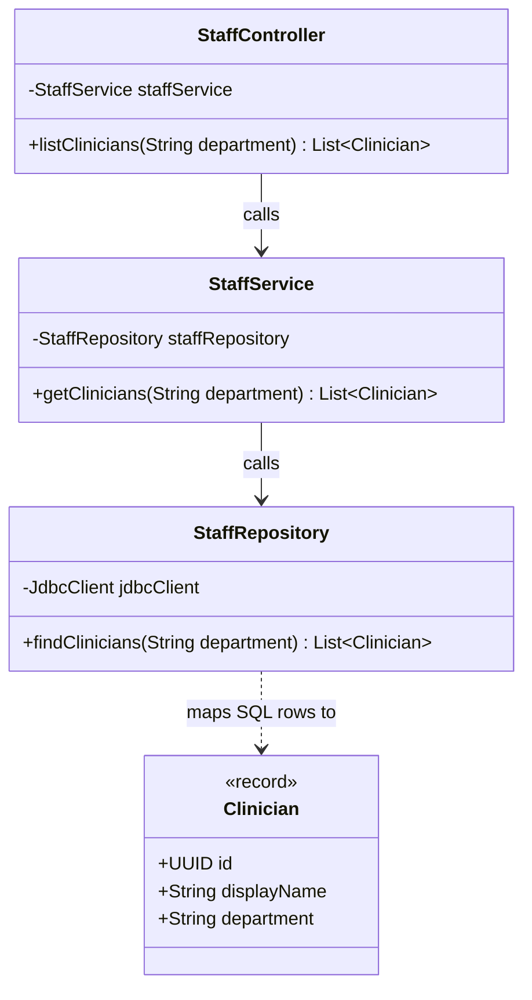
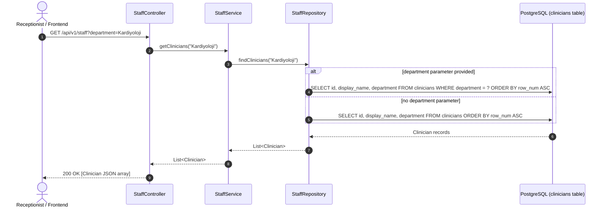

# US-09 / Issue #204: Backend Clinician Directory & Filter Architecture

## 1. Scope & Objective
This documentation covers the backend implementation for **US-09** (*List doctors by department*) and **Issue #204** (*[Backend] Expose department and filtered doctor lists*).

It satisfies the requirement for hospital staff to retrieve clinicians, either as a complete list or filtered by department name, directly against the seeded relational database.

---

## 2. API Contract
Uses the existing endpoint defined in `api/openapi.yaml`:
- **Path:** `GET /api/v1/staff`
- **Query Parameter:** `department` (optional string, e.g. `Kardiyoloji`)
- **Success Response:** `200 OK` returning `Clinician[]`:
  ```json
  [
    {
      "id": "21e2a9c9-04a7-51cd-bb50-8652e2278c37",
      "displayName": "Doç. Dr. Ayşe ÖZDEMİR",
      "department": "Kardiyoloji"
    }
  ]
  ```
- **Empty / Non-Existent Filter Handling:** Returns HTTP `200 OK` with an empty array `[]` when no clinicians match the specified filter.

---

## 3. Class Design (UML Class Diagram)



---

## 4. Interaction Flow (UML Sequence Diagram)


