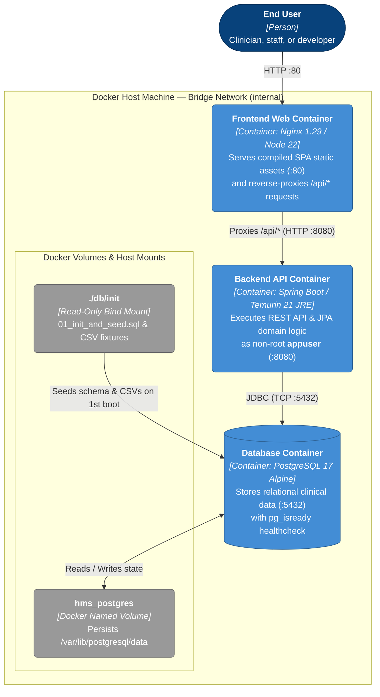
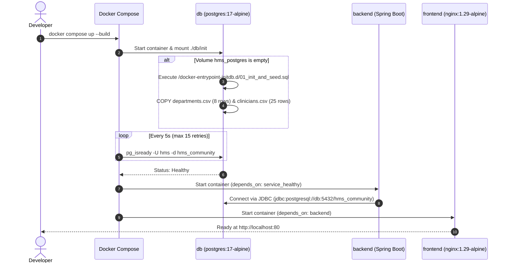

## Containerization & Runtime Deployment Architecture
### Windows Setup & Usage
Project members need to download and install [Docker Desktop for Windows](https://www.docker.com/products/docker-desktop/) to run the full application stack with a single command. Using the WSL 2 backend is strongly recommended for faster file I/O and native Linux container compatibility—see the [Microsoft WSL Installation Guide](https://learn.microsoft.com/en-us/windows/wsl/install) to set it up before launching Docker Desktop.

After installing, the project can be run with a single command by launching cmd, cd into the project directory, and running `docker compose up --build`
frontend will bind to port 80 (browsers can connect to http://localhost:80) and backend will bind to port 8080 (ensure localhost:8080/api/v1/health returns success). db will not bind to any port, it will seed data from db/init/ . 


### Architectural Rationale
environment parity across all developer workstations and elimination of host-level dependency conflicts (`Java`, `Maven`, `Node.js`, `PostgreSQL`).
All decisions align with industry standard practices.
The system is decomposed into three isolated containers orchestrated to run with a single command via Docker Compose (`compose.yaml`):

1. **Process Isolation & Lifecycle Decoupling:** Separating the presentation tier (`frontend`), application tier (`backend`), and persistence tier (`db`) allows independent rebuilds and restarts without data loss.
2. **Multi-Stage Builds:** Both `backend` and `frontend` compile source code inside heavy SDK builder images (`maven:3.9-eclipse-temurin-21` and `node:22-alpine`) and copy only compiled artifacts (`.jar` and static `/dist` assets) into minimal runtime images (`eclipse-temurin:21-jre` and `nginx:1.29-alpine`).
3. **Least-Privilege Execution:** The Spring Boot container runs under an unprivileged system user (`appuser`, UID `10001`) rather than `root`.
4. **Network Segmentation:** PostgreSQL is isolated on the private `internal` Docker bridge network with no host port exposure; only `frontend` (`:80`) and `backend` (`:8080`) bind to host ports.

### Container & Deployment Diagram


# Compose Usage and Health Check Sequence Diagram: 


```

