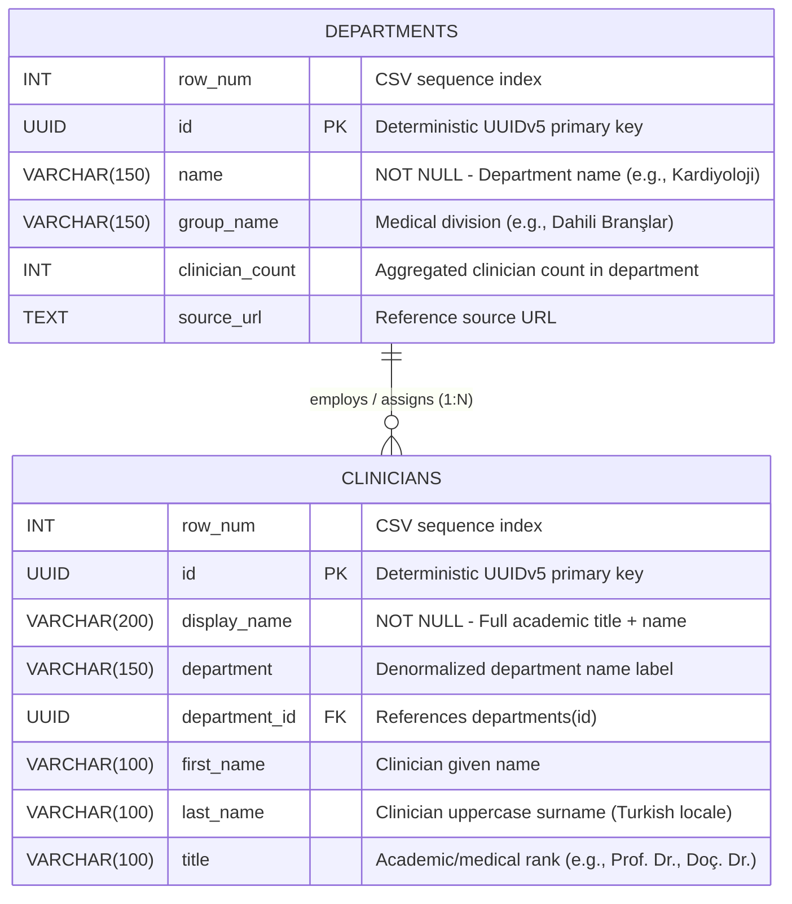

# Database Schema & Synthetic Seed Documentation

## 1. Overview
The relational persistence layer runs on **PostgreSQL 17** (`hms_community` database). Initial schema creation and synthetic fixture loading are automated via `/docker-entrypoint-initdb.d/01_init_and_seed.sql`, which imports `departments.csv` followed by `clinicians.csv` using PostgreSQL's native `COPY` command to preserve referential integrity.

Synthetic data was formulated from the real db by replacing PII with generated data.

## 2. Entity-Relationship Diagram (UML / Crow's Foot)



## 3. Data Dictionary

### Table: `departments`
Stores clinical departments and medical branch groupings (`8` seeded records in `departments.csv`).

| Column | Data Type | Constraints | Description |
| :--- | :--- | :--- | :--- |
| `row_num` | `INT` | Nullable | Sequential row number from source CSV (`1`–`8`). |
| `id` | `UUID` | `PRIMARY KEY` | Unique UUIDv5 identifier for the department. |
| `name` | `VARCHAR(150)` | `NOT NULL` | Official Turkish department name (e.g., `Adli Tıp`, `Kardiyoloji`, `Nöroloji`). |
| `group_name` | `VARCHAR(150)` | Nullable | High-level medical division (`Dahili Branşlar`, `Cerrahi Branşlar`, `Temel Tıp Bilimleri`). |
| `clinician_count` | `INT` | Nullable | Total number of seeded clinicians assigned to this department. |
| `source_url` | `TEXT` | Nullable | Institutional reference URL used during fixture generation. |

### Table: `clinicians`
Stores medical practitioners and their department assignments (`25` seeded records in `clinicians.csv`).

| Column | Data Type | Constraints | Description |
| :--- | :--- | :--- | :--- |
| `row_num` | `INT` | Nullable | Sequential row number from source CSV (`1`–`25`). |
| `id` | `UUID` | `PRIMARY KEY` | Unique UUIDv5 identifier for the clinician. |
| `display_name` | `VARCHAR(200)` | `NOT NULL` | Formatted full name including academic/medical title (e.g., `Prof. Dr. Zeynep ÖZKAN`). |
| `department` | `VARCHAR(150)` | Nullable | Human-readable department name matching `departments.name`. |
| `department_id` | `UUID` | `FOREIGN KEY` | References `departments(id)` (`ON DELETE RESTRICT`). Establishes the 1:N lookup relationship for US-09. |
| `first_name` | `VARCHAR(100)` | Nullable | Clinician's given name(s). |
| `last_name` | `VARCHAR(100)` | Nullable | Clinician's family name formatted with Turkish uppercase rules (`İ`, `Ş`, `Ç`, `Ğ`, `Ü`, `Ö`). |
| `title` | `VARCHAR(100)` | Nullable | Academic or clinical rank (`Prof. Dr.`, `Doç. Dr.`, `Dr. Öğr. Üyesi`, `Uzm. Dr.`, `Op. Dr.`). |

## 4. Seeding & Verification Notes
* **Load Order:** `departments` is populated before `clinicians` so all `department_id` foreign key constraints resolve cleanly during `COPY`.
* **Verification Query:**
  ```sql
  SELECT d.name AS department, COUNT(c.id) AS actual_count, d.clinician_count AS expected_count
  FROM departments d
  LEFT JOIN clinicians c ON c.department_id = d.id
  GROUP BY d.id, d.name, d.clinician_count;
  ```
