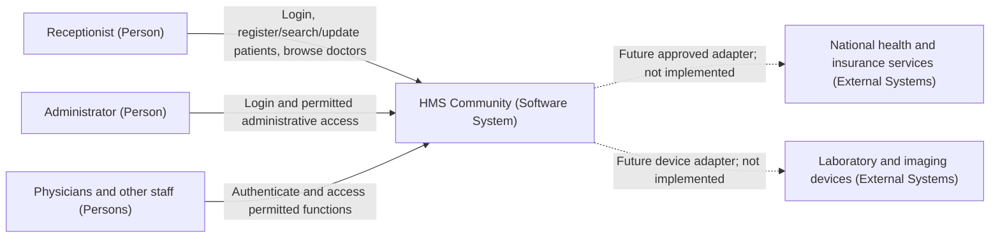
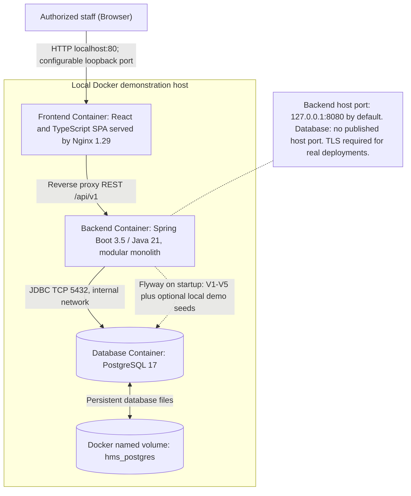
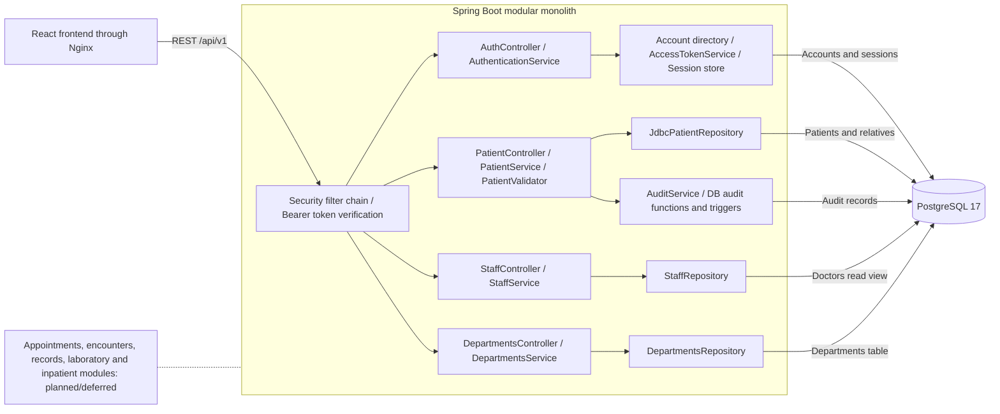
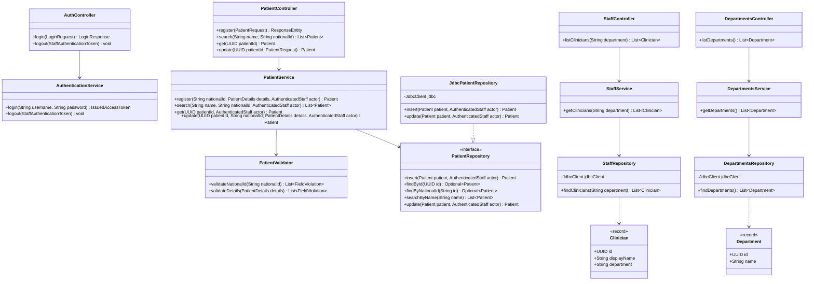
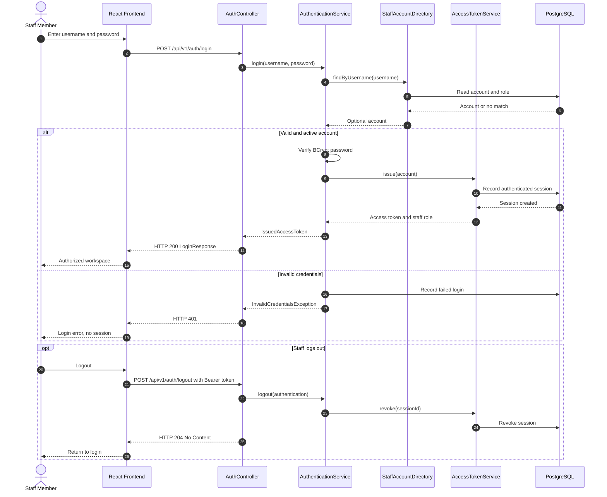
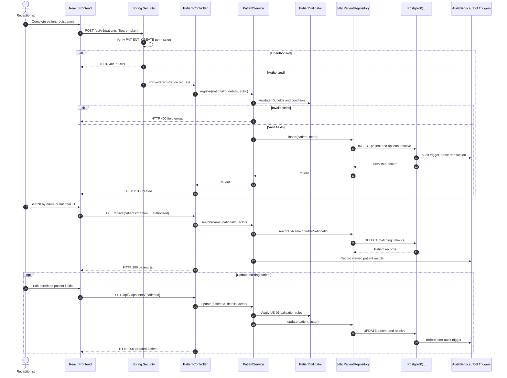
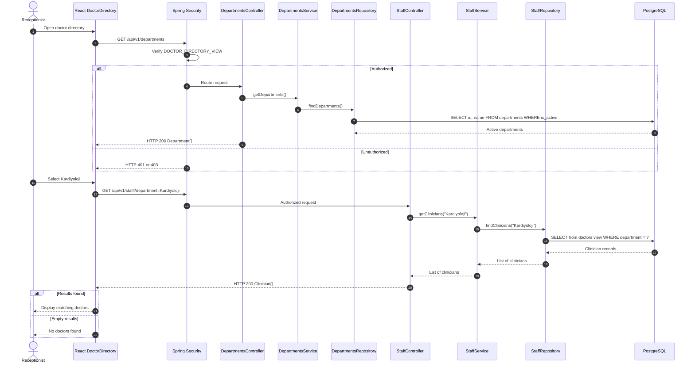
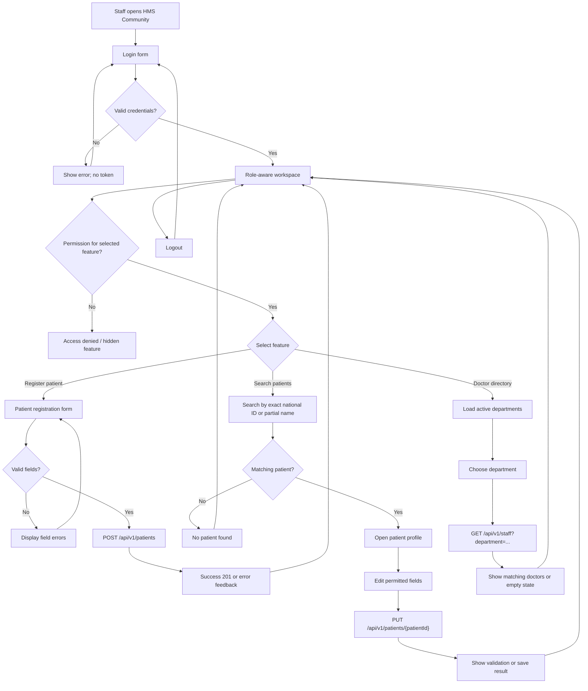
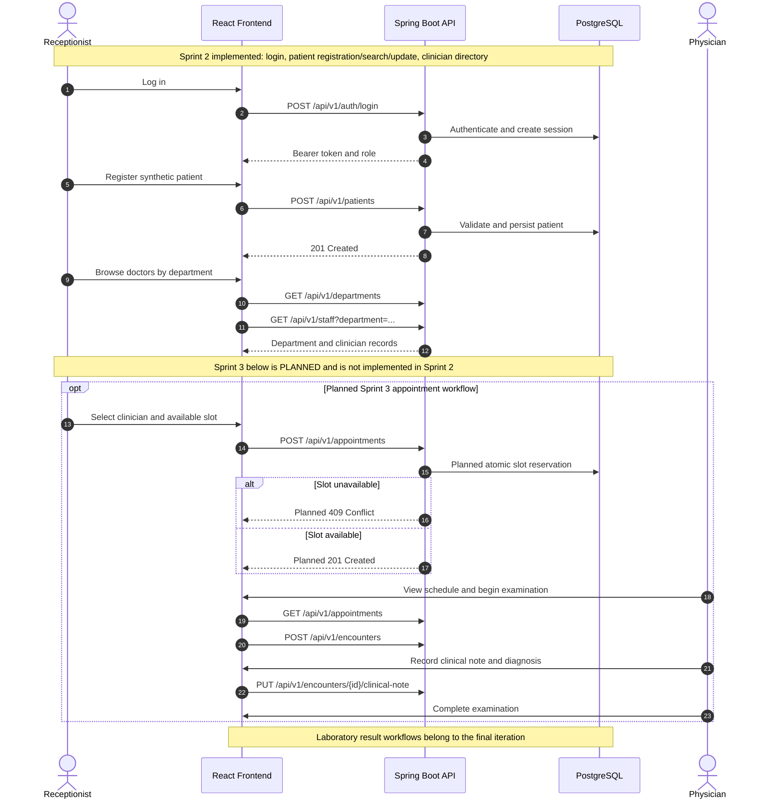

# Sprint 2 — C4 and UML Architecture

**Project:** HMS Community — Team 15

**Date:** 23 November 2026

**Architect:** Habib Yazar

**Status:** Sprint 2 architecture documentation baseline.

The diagrams distinguish implemented Sprint 2 components from planned Sprint 3/final functionality. All local demonstration data is synthetic.

## 1. C4 Level 1 — System Context

## 2. C4 Level 2 — Containers

## 3. C4 Level 3 — Backend Components

## 4. UML Implementation Class Diagram

## 5. UML Authentication Sequence

## 6. UML Patient Management Sequence

## 7. UML Doctor Directory Sequence

## 8. Sprint 2 User Flows

## 9. Planned Sprint 3 MVP Sequence

## 10. Database Schema

The detailed PostgreSQL ER model is maintained in [database-er.mmd](../architecture/database-er.mmd). Migrations V1-V5 are installed through Flyway. The patient gender restriction is updated by V5.

## 11. Design Decisions and Traceability

- [Architecture Decision Records](../adr/0001-modular-monolith.md)
- [US-09 Backend Design](../architecture/US-09-backend-architecture.md)
- [Docker Deployment Design](../architecture/containers-architecture.md)
- [Software Requirements Specification](../SRS.md)
- [Sprint 2 Verification Report](README.md)

**Figma status:** These Mermaid user flows are not a substitute for the required Figma UI/UX prototype. Add the team's Figma design and prototype links to the final Teams submission after verification.
